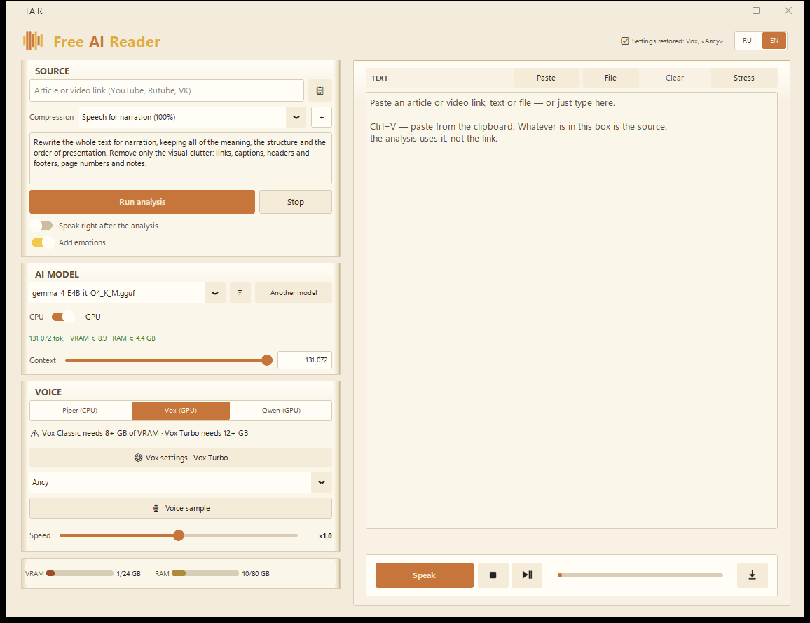

# Free AI Reader (FAIR)

Offline AI reader for Windows. Paste an article or video link (YouTube / Rutube /
VK) or any text — a local AI model condenses it to the length you choose, and the
app reads the result aloud.
Everything runs on your machine: analysis via llama.cpp (GGUF), speech via
**Piper (fast)**, **VOX (high quality) — VOX can also clone your own voice**
from a 5–15 s microphone sample, or **Qwen3-TTS** (cloning, ready expressive
voices, voice design from a text description). No cloud, no subscription.

License: GPL-3.0 · UI: English / Russian



## English

### Features

- **Source**: article link (text extracted automatically), **video link** (YouTube,
  Rutube, VK — narration is built from the subtitle track; language selectable),
  pasted text, or a file (pdf / docx / txt / md / fb2 / epub / rtf / html). For
  multi-chapter FB2/EPUB books the app asks which chapter to narrate.
- **Condensing**: ready profiles (10 %, 30 %, 50 %, 100 %) and custom levels
  with your own prompt.
- **Translation**: the result can be in another language — say so in the prompt
  (“translate into English”, “into German”) and the model returns only the
  translation, without the original text. If the prompt does not ask for another
  language, the result stays in the language of the source text.
- **Speech**: Piper (fast, CPU) or VOX (high quality, clone your own voice from a
  5–15 s mic sample; the VOX voices **Alsu** (Russian) and **John** ship built in). Speech rate,
  pause between chunks, autoplay after analysis. The ⏯ button pauses playback
  mid-sentence and resumes exactly where you left off; after the clip ends it
  plays from the start. Finished narration can be **saved to an audio file**.
- **Emotions**: a voice can carry its own emotional samples — 26 ready
  emotion prompts, recorded by microphone or synthesized by VOX itself in one
  click. A marker like `(joyful)` in the narration switches the voice to that
  emotion for its own sentence; with the “Add emotions” switch on, the AI places
  those markers itself and uses only the emotions the voice really has. Emotion
  lines follow the language of the voice sample (an English voice gets English
  emotion lines).
- **Qwen3-TTS engine** (optional, GPU): clone your voice from a mic sample,
  9 built-in expressive voices, or design a brand-new voice from a text
  description (“young woman, gentle whisper”). Needs ~4 GB VRAM for the 0.6B
  model or 6–8 GB for 1.7B — the app asks which size to install and downloads
  the models itself.
- **Analysis model**: any GGUF; Gemma 4 E4B Q4_K_M (≈5 GB) is offered by default.
  The app shows how much VRAM/RAM each context length will really need.
- **Integration**: local API + MCP bridge (`fair_status`, `fair_speak`) so AI
  assistants can start narration from the command line — no Python required.
- Copy the result, Stop at any moment, a calm paper-and-gold “old book” colour scheme.

### Install

1. Download `FAIR-Setup-<version>.exe` from [Releases](../../releases).
2. Run it, pick a folder, optionally create a desktop shortcut. No admin rights
   required — it installs to `%LOCALAPPDATA%\Programs\Free AI Reader`.
3. On first launch the app offers to **download the Gemma model (≈5 GB)** —
   with progress and resume. On a PC with NVIDIA the CUDA build of llama.cpp is
   fetched in the same one-shot download (≈5.6 GB total), so the GPU mode just
   works. Voices **Irina, Ruslan** and `en_US-ljspeech-high`
   are bundled in the installer, and with **Vox** selected the sample voices
   **Alsu** (Russian) and **John** are pre-registered in the voice
   list. With **Piper** selected, the button
   **📂 Your Piper voice…** under the voice list imports any Piper voice from your
   computer — pick `name.onnx` (with `name.onnx.json` next to it): the voice is
   copied into the app folder and appears in the list. If a bundled Irina/Ruslan
   file goes missing, the app re-downloads it on next launch.
4. **VOX engine** (optional, ≈1.5 GB download, ≈3 GB on disk) is offered on first
   launch; it installs into `%LOCALAPPDATA%\FAIR\vox` and needs a GPU with 8 GB VRAM.
   Decline it and the app works with Piper.

App data (settings, models, voices): `%LOCALAPPDATA%\FAIR`.

### Self-check without opening the window

```
set FAIR_SELFCHECK=1
"%LOCALAPPDATA%\Programs\Free AI Reader\FAIR.exe"
```

Report: `%TEMP%\fair_selfcheck.json` — imports, voice presence, real speech synthesis.

## Русский

### Что умеет

- **Источник**: ссылка на статью (текст вытаскивается автоматически), **ссылка на
  видео** (YouTube, Rutube, VK — озвучка строится по субтитрам, язык дорожки
  выбирается), вставленный текст или файл (pdf / docx / txt / md / fb2 / epub /
  rtf / html). Для многотомных FB2/EPUB приложение спросит, какую главу озвучить.
- **Сжатие**: готовые профили (10 %, 30 %, 50 %, 100 %) и свои уровни
  с собственным промтом.
- **Перевод**: результат может быть на другом языке — скажи это в промте
  («переведи на английский», «на немецкий»), и модель вернёт только перевод,
  без исходного текста. Если язык в промте не назван, результат остаётся
  на языке исходного текста.
- **Озвучка**: Piper (быстрая, на процессоре), VOX (качественная; возможна
  озвучка твоим голосом — VOX клонирует его по образцу 5–15 секунд с микрофона;
  в комплекте уже есть готовые голоса **Алсу** (русский) и **Джон**) или
  **Qwen3-TTS** (клонирование, готовые выразительные голоса, дизайн голоса по
  описанию). Скорость речи, пауза между
  фрагментами, автоплей после анализа. Кнопка ⏯ ставит воспроизведение на паузу
  посреди фразы и продолжает с того же места; после конца — играет сначала.
  Готовую озвучку можно **сохранить в аудиофайл**.
- **Эмоции**: у голоса могут быть свои эмоциональные образцы — 26 готовых
  фраз-подсказок, запись с микрофона или синтез самим VOX в один клик. Маркер
  вида `(радостный)` в тексте озвучки переключает голос на эту эмоцию для своей
  фразы; с тумблером «Добавить эмоции» нейросеть расставляет такие маркеры сама
  и берёт только те эмоции, что у голоса реально записаны. Язык эмоциональных
  фраз повторяет язык образца голоса (английский голос — английские фразы).
- **Движок Qwen3-TTS** (опционально, видеокарта): клон голоса по образцу с
  микрофона, 9 готовых выразительных голосов, а также дизайн нового голоса по
  текстовому описанию («молодая девушка, ласковый шёпот»). Нужно ~4 ГБ
  видеопамяти для модели 0.6B или 6–8 ГБ для 1.7B — приложение само спрашивает,
  какой размер ставить, и само скачивает модели.
- **Модель анализа**: любая GGUF; по умолчанию предлагается Gemma 4 E4B Q4_K_M (≈5 ГБ).
  Приложение честно показывает, сколько видеопамяти и ОЗУ займёт выбранный
  контекст.
- **Интеграция**: локальный API + MCP-мост (`fair_status`, `fair_speak`) —
  ИИ-ассистенты могут запускать озвучку из командной строки, Python на машине
  не нужен.
- Копирование результата, «Стоп» в любой момент, спокойная «книжная» гамма — бумага, кожа, золото.

### Установка

1. Скачать `FAIR-Setup-<версия>.exe` из [Releases](../../releases).
2. Запустить, выбрать папку, при желании — ярлык на рабочем столе. Без прав
   администратора: ставится в `%LOCALAPPDATA%\Programs\Free AI Reader`.
3. При первом запуске приложение само предложит **скачать модель Gemma (≈5 ГБ)** —
   с прогрессом и докачкой. На ПК с NVIDIA тем же скачиванием сразу догружается
   CUDA-сборка llama.cpp (≈5,6 ГБ суммарно) — режим «Видеокарта» работает сразу.
   Голоса **Ирина, Руслан** и `en_US-ljspeech-high`
   уже входят в установщик, а при движке **Vox** в списке голосов сразу готовы
   образцы **Алсу** (русский) и **Джон**. При движке **Piper** под списком голосов есть кнопка
   **📂 Свой голос Piper…** — импорт любого Piper-голоса с компьютера: выбираешь
   `name.onnx` (рядом должен лежать `name.onnx.json`), голос копируется в папку
   приложения и появляется в списке. Если файлы Ирины или Руслана пропадут —
   приложение докачает их само.
4. **Vox (нейроголос по образцу с микрофона)** — необязательное дополнение
   (≈1,5 ГБ загрузки, ~3 ГБ на диске, нужна видеокарта с 8 ГБ видеопамяти).
   Ставится в `%LOCALAPPDATA%\FAIR\vox`, системный Python не нужен.
   Отказаться можно — тогда работает Piper.

**Данные приложения** (настройки, модели, голоса) — `%LOCALAPPDATA%\FAIR`.
При удалении установщик спросит, удалять ли эту папку.

### Проверка установки без запуска окна

```
set FAIR_SELFCHECK=1
"%LOCALAPPDATA%\Programs\Free AI Reader\FAIR.exe"
```

Отчёт: `%TEMP%\fair_selfcheck.json` — импорты, наличие голоса, реальный синтез фразы.

## Build from source / Сборка из исходников

```
python -m venv .venv
.venv\Scripts\pip install -r requirements.txt

rem приложение (run from sources)
.venv\Scripts\python modern_app_v2.py

rem установщик (installer)
.venv\Scripts\pyinstaller build_installer\fair.spec --noconfirm --distpath dist_installer
"%LOCALAPPDATA%\Programs\Inno Setup 6\ISCC.exe" build_installer\fair.iss
```

В установщик входят голоса `en_US-ljspeech-high` (LJSpeech, public domain) и русские
`ru_RU-irina` / `ru_RU-ruslan` под CC BY-NC-SA (атрибуция в `THIRD-PARTY.md`,
коммерческое использование запрещено). Если собираешь без них — убери соответствующие
строки из `build_installer/fair.spec`.

## Licenses / Лицензии

Code — GPL-3.0 (see `LICENSE`): required by the `piper-tts 1.6.0` dependency.
Third-party components and terms — see `THIRD-PARTY.md`. The Gemma model is
downloaded separately and is governed by the Gemma Terms of Use.

Код — GPL-3.0 (см. `LICENSE`): этого требует зависимость `piper-tts 1.6.0`.
Сторонние компоненты и условия — в `THIRD-PARTY.md`. Модель Gemma скачивается
отдельно и регулируется Gemma Terms of Use.
