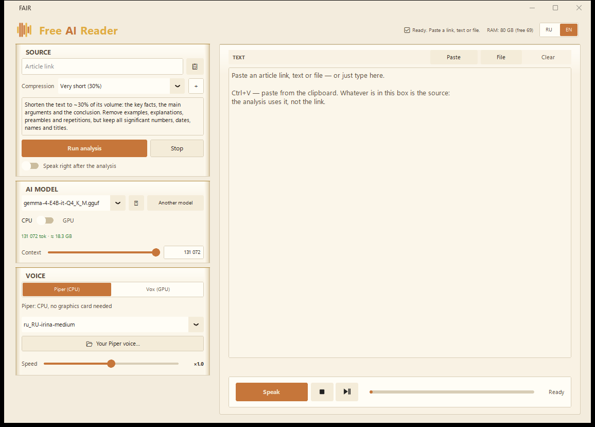

# Free AI Reader (FAIR)

Offline AI reader for Windows. Paste an article link or any text — a local AI model
condenses it to the length you choose, and the app reads the result aloud.
Everything runs on your machine: analysis via llama.cpp (GGUF), speech via
**Piper (fast)** or **VOX (high quality) — VOX can also clone your own voice**
from a 5–15 s microphone sample. No cloud, no subscription.

License: GPL-3.0 · UI: English / Russian



## English

### Features

- **Source**: article link (text extracted automatically), pasted text, or a file
  (pdf / docx / txt).
- **Condensing**: ready profiles (10 %, 30 %, 50 %, 100 %) and custom levels
  with your own prompt.
- **Speech**: Piper (fast, CPU) or VOX (high quality, clone your own voice from a
  5–15 s mic sample). Speech rate, pause between chunks, autoplay after analysis.
  The ⏯ button pauses playback mid-sentence and resumes exactly where you left off;
  after the clip ends it plays from the start.
- **Analysis model**: any GGUF; Gemma 4 E4B Q4_K_M (≈5 GB) is offered by default.
- Copy the result, Stop at any moment, "Graphite" theme.

### Install

1. Download `FAIR-Setup-<version>.exe` from [Releases](../../releases).
2. Run it, pick a folder, optionally create a desktop shortcut. No admin rights
   required — it installs to `%LOCALAPPDATA%\Programs\Free AI Reader`.
3. On first launch the app offers to **download the Gemma model (≈5 GB)** —
   with progress and resume. Voices **Irina, Ruslan** and `en_US-ljspeech-high`
   are bundled in the installer. More ready voices (Amy, Alan, Thorsten) —
   button **⬇** next to the Voice list.
4. **VOX engine** (optional, ≈1.5 GB download, ≈3 GB on disk) is offered on first
   launch; it installs into `%LOCALAPPDATA%\FAIR\vox` and needs a GPU with 8 GB VRAM.
   Decline it and the app works with Piper.

App data (settings, models, voices): `%LOCALAPPDATA%\FAIR`.

### Self-check without opening the window

```
set FAIR_SELFCHECK=1
"%LOCALAPPDATA%\Programs\Free AI Reader\FAIR.exe"
```

Report: `%TEMP%\fair_selfcheck.json` — imports, voice presence, real speech synthesis.

## Русский

### Что умеет

- **Источник**: ссылка на статью (текст вытаскивается автоматически), вставленный
  текст или файл (pdf / docx / txt).
- **Сжатие**: готовые профили (10 %, 30 %, 50 %, 100 %) и свои уровни
  с собственным промтом.
- **Озвучка**: Piper (быстрая, на процессоре) или VOX (качественная; возможна
  озвучка твоим голосом — VOX клонирует его по образцу 5–15 секунд с микрофона).
  Скорость речи, пауза между
  фрагментами, автоплей после анализа. Кнопка ⏯ ставит воспроизведение на паузу
  посреди фразы и продолжает с того же места; после конца — играет сначала.
- **Модель анализа**: любая GGUF; по умолчанию предлагается Gemma 4 E4B Q4_K_M (≈5 ГБ).
- Копирование результата, «Стоп» в любой момент, тема «Графит».

### Установка

1. Скачать `FAIR-Setup-<версия>.exe` из [Releases](../../releases).
2. Запустить, выбрать папку, при желании — ярлык на рабочем столе. Без прав
   администратора: ставится в `%LOCALAPPDATA%\Programs\Free AI Reader`.
3. При первом запуске приложение само предложит **скачать модель Gemma (≈5 ГБ)** —
   с прогрессом и докачкой. Голоса **Ирина, Руслан** и `en_US-ljspeech-high`
   уже входят в установщик. Добавить готовые голоса (Amy, Alan, Thorsten) —
   кнопка **⬇** рядом со списком «Озвучка».
4. **Vox (нейроголос по образцу с микрофона)** — необязательное дополнение
   (≈1,5 ГБ загрузки, ~3 ГБ на диске, нужна видеокарта с 8 ГБ видеопамяти).
   Ставится в `%LOCALAPPDATA%\FAIR\vox`, системный Python не нужен.
   Отказаться можно — тогда работает Piper.

**Данные приложения** (настройки, модели, голоса) — `%LOCALAPPDATA%\FAIR`.
При удалении установщик спросит, удалять ли эту папку.

### Проверка установки без запуска окна

```
set FAIR_SELFCHECK=1
"%LOCALAPPDATA%\Programs\Free AI Reader\FAIR.exe"
```

Отчёт: `%TEMP%\fair_selfcheck.json` — импорты, наличие голоса, реальный синтез фразы.

## Build from source / Сборка из исходников

```
python -m venv .venv
.venv\Scripts\pip install -r requirements.txt

rem приложение (run from sources)
.venv\Scripts\python modern_app_v2.py

rem установщик (installer)
.venv\Scripts\pyinstaller build_installer\fair.spec --noconfirm --distpath dist_installer
"%LOCALAPPDATA%\Programs\Inno Setup 6\ISCC.exe" build_installer\fair.iss
```

В установщик входят голоса `en_US-ljspeech-high` (LJSpeech, public domain) и русские
`ru_RU-irina` / `ru_RU-ruslan` под CC BY-NC-SA (атрибуция в `THIRD-PARTY.md`,
коммерческое использование запрещено). Если собираешь без них — убери соответствующие
строки из `build_installer/fair.spec`.

## Licenses / Лицензии

Code — GPL-3.0 (see `LICENSE`): required by the `piper-tts 1.6.0` dependency.
Third-party components and terms — see `THIRD-PARTY.md`. The Gemma model is
downloaded separately and is governed by the Gemma Terms of Use.

Код — GPL-3.0 (см. `LICENSE`): этого требует зависимость `piper-tts 1.6.0`.
Сторонние компоненты и условия — в `THIRD-PARTY.md`. Модель Gemma скачивается
отдельно и регулируется Gemma Terms of Use.
